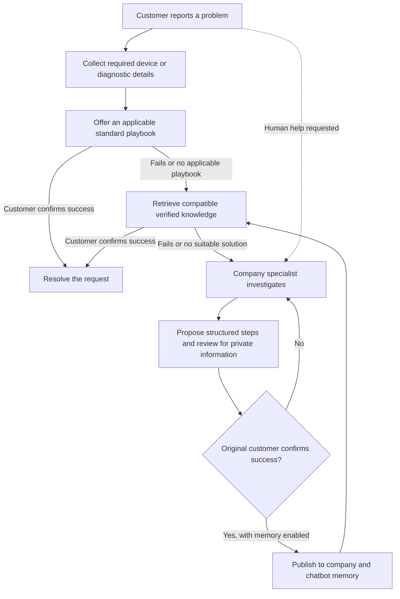

# Continuum AI

### Support that remembers what works.

Continuum AI is a multi-company support platform that turns customer-confirmed specialist resolutions into reusable troubleshooting knowledge. Customers receive a standard check first, then a compatible solution from shared company memory, with a clear path to human support when neither resolves the issue.

One account can access multiple companies. Each company can run distinct support services, manage its own specialists and customers, and build a knowledge library that stays within its authorized workspace.

**Project status:** Working prototype with a reproducible fictional demo, 79 passing automated tests, and browser-verified cross-customer resolution reuse.

[Try the demo](#quick-start) · [How it works](#how-it-works) · [Architecture](#architecture) · [Verification](#verification) · [Documentation](#documentation)

---

## The problem

Support teams repeatedly investigate problems they have already solved. Useful answers remain scattered across conversations, individual specialists and closed tickets. Customers repeat their history, chatbots repeat unsuccessful suggestions, and support knowledge disappears when a case ends.

Continuum preserves that operational knowledge through a controlled feedback loop: a specialist proposes a reviewed solution, the original customer confirms the outcome, and compatible customers can receive those verified steps in future conversations.

The intended benefit is less repeated diagnosis and a smoother handoff between automation and people. The current evidence demonstrates the software workflow on synthetic cases; production time savings and customer-impact metrics have not yet been measured.

## What Continuum delivers

| Capability | Implemented behavior |
| --- | --- |
| Multi-company accounts | One global account, multiple memberships, and a separate role in each company. |
| Configurable support services | Independent repair and IT chatbot configurations, with topics, diagnostic requirements, playbooks, allowed actions and escalation rules. |
| Standard-first troubleshooting | A configured standard playbook precedes learned reuse; irrelevant playbooks are explicitly skipped. |
| Shared resolution memory | Reviewed, customer-confirmed solutions become reusable within the same company and chatbot. |
| Human support workspace | Specialists inspect conversations and attempted fixes, claim cases, post updates and propose structured resolutions. |
| Outcome feedback | Explicit success/failure controls, durable attempts, reuse statistics and review after unsuccessful reuse. |
| Secure customer imports | Owner-triggered gateway lookups and verified-identity linking without creating accounts or granting privileges implicitly. |
| Continuous case history | Requests, conversations, attempts and confirmations persist across refreshes, sessions and server restarts. |
| Customer controls | Workspace switching, source inspection, optional AI memory, request notes and appointment management. |

## How it works



For each issue, the prototype permits at most one applicable standard fix and one learned fix before human escalation. A direct request for human help bypasses troubleshooting; its prepared handoff still requires explicit submission confirmation. Configured urgent conditions also provide an immediate specialist route.

A helpful rating, positive reaction or silence never counts as resolution. Customers explicitly choose **It worked** or **Still need help**. Missing details prompt a plain-language clarification; customers who do not know their device details can ask a specialist rather than getting stuck in repeated questions.

### Learning through verified retrieval

Continuum does not train or update model weights. It retrieves and reuses approved knowledge.

- **Private case context:** conversations, preferences, diagnostic details and attempt history remain within the customer's company/service scope.
- **Shared knowledge:** reviewed symptoms, applicability conditions, verified steps, provenance and reuse outcomes belong to a specific company and chatbot.
- **Publication:** a specialist reviews the reusable content for private information, and the original customer must confirm success before it becomes available to others.
- **Compatibility:** product and version restrictions are checked independently of relevance. Uncertain applicability prompts clarification; conflicting environments are excluded.
- **Recovery:** failed reuse reaches human support and pauses the solution for review. Equivalent failed steps are suppressed for the affected customer, even after re-publication.
- **Presentation:** customers receive ordinary troubleshooting advice. Specialist attribution remains available in source details rather than appearing in the main recommendation.

Turning AI memory off disables optional recall and retention for that exchange. Operational records remain available to maintain the case, prevent duplicate actions and preserve workflow state. A specialist solution confirmed with memory off resolves privately without shared-memory publication.

## Quick start

### Requirements

- **Node.js 22** is the verified runtime; `.nvmrc` identifies the project version.
- Use Linux, macOS or WSL with dependencies installed for that environment. On this Windows development setup, testing runs in WSL because `better-sqlite3` is a native module.
- Run the commands below from a checkout containing this implementation.

### Explore the complete demo

```sh
npm ci
npm run demo:multi -- --serve
```

Open **http://localhost:3211/desk**.

The command creates a fresh temporary SQLite database, runs the asserted multi-company scenario, and starts the website with fictional records. Email, calendar, model, Hindsight and company-gateway integrations are disabled for this demo.

| Role | Fictional email |
| --- | --- |
| Company A owner | `owner-a@example.test` |
| Company B owner | `owner-b@example.test` |
| Customer One | `one@example.test` |
| Customer Two | `two@example.test` |

**Password for these demo accounts:** `fictional demo passphrase 2026`

These are local demonstration credentials, not production accounts. Customer One can switch between two company memberships. Owners are routed to company management; customers are routed to their own requests.

To run the asserted scenario without starting the website:

```sh
npm run demo:multi
```

Add `--keep` to preserve the generated fictional database and print its location. The default non-server run removes its temporary database afterward.

### Run a regular local workspace

```sh
cp .env.example .env
npm start
```

With the example configuration, open **http://localhost:3100/desk**. Choose **Create a company**, then use **Company & team** to configure services, generate customer signup links and create email-bound invitations. Use individual customer and specialist accounts to exercise their different permissions.

For an existing account, **Join a company** adds another membership using a signup code or invitation. Selecting a company or service switches the active workspace directly.

New accounts begin with an empty workspace. Passwords must contain 15–128 characters. Development can run without email delivery; production requires verified email and the corresponding delivery configuration. See [SETUP.md](SETUP.md) for complete setup instructions.

## Demonstration scenario

The reproducible demo verifies this sequence:

1. **Customer One reports a problem.** The configured standard check fails, and the case enters Company A's human queue.
2. **A specialist resolves the case.** The specialist claims it, proposes structured steps, reviews the reusable content and waits for customer confirmation.
3. **Customer One confirms success.** The approved solution becomes available in Company A's repair-service memory.
4. **Customer Two reports a compatible issue.** The standard check is offered first. After it fails, the chatbot retrieves the confirmed solution and records a successful reuse outcome.
5. **A separate learned attempt fails.** The issue reaches the human queue and the knowledge enters review.
6. **Isolation is checked.** Company B and Company A's unrelated IT service cannot retrieve the repair solution. One customer switches between A and B without creating a second account.

The same lifecycle was also verified in the browser for a charging issue: a newly registered Customer B received the standard charging check, then Customer A's confirmed solution, and completed the request through explicit feedback. The repair instructions and successful outcomes in that demonstration were fictional/simulated. See [CHARGING-TEST.md](CHARGING-TEST.md) for the observed steps and evidence.

## Architecture

| Layer | Technology and responsibility |
| --- | --- |
| Web application | Vanilla JavaScript, semantic HTML and responsive CSS; customer desk, company management and specialist console. |
| Application server | Node.js HTTP API; authentication, authorization, workflow transitions, confirmations and integration orchestration. |
| Durable storage | SQLite through `better-sqlite3`; relational account/workspace tables and indexed application records, with transactions and uniqueness constraints. |
| Memory | Hindsight integration for configured remote retention/recall, plus a local fallback for reproducible demonstrations. Local scope and publication checks remain authoritative. |
| Language model | Optional OpenAI-compatible endpoint for interpretation and response composition; permissions and state transitions remain server-controlled. |
| Business gateway | Allowlisted HTTPS contract for customer lookup, service-record imports and optional acknowledged action delivery. |
| Optional integrations | Resend email and Google Calendar OAuth, backed by encrypted credentials and durable delivery jobs. |

### Repository map

```text
server/
  app.js                 HTTP routes and orchestration
  auth.js                Accounts, sessions and workspace selection
  companies.js           Membership and company management
  chatbots.js            Service configuration and stable identities
  troubleshooting.js     Persisted standard / learned / human workflow
  learning.js            Specialist review, confirmation and publication
  reuse.js               Reuse outcomes, suppression and review
  customer-advice.js     Customer-facing presentation of verified steps
  memory.js              Hindsight, local memory and synchronization
  connector.js           Customer directory and service-record gateway
  database.js            SQLite storage and versioned migrations
web/                     Customer, owner and specialist interfaces
scripts/                 Demo, verification, evaluation and backup tools
test/                    Automated regression and integration coverage
evaluation/              Synthetic retrieval datasets and evaluation material
```

### Data integrity and access control

Global accounts use stable internal IDs and unique normalized email addresses. Company memberships hold company-specific roles and active/revoked status. Sessions explicitly select a company and chatbot, and protected operations revalidate current membership. Stale workspace submissions and forged references cannot select another customer's case or another company's knowledge.

Database uniqueness and transactional writes prevent duplicate memberships, attempts and active-case submissions. Finalized fix feedback cannot be overwritten by conflicting feedback. Specialist updates retain revision/conflict protection and audit history.

**Migration 4** is additive, transactional and versioned. It backfills memberships and repair/IT chatbot identities while preserving account IDs, credentials, safe sessions, tickets, conversations, connector mappings, resolutions and audit records. Legacy shared knowledge remains within its original authorized domain. See [MULTI-COMPANY.md](MULTI-COMPANY.md) for migration behavior and remote-memory re-publication details.

Authentication includes scrypt password hashing, opaque hashed sessions, HttpOnly cookies, CSRF protection, rate limits, expiring one-use verification/reset links and session revocation. Production uses secure cookies and HTTPS. Integration credentials remain encrypted server-side.

## Integration configuration

External services are optional for the fictional demo. Configure the regular application through environment variables:

| Integration | Main settings |
| --- | --- |
| Application and storage | `APP_URL`, `FRONTEND_PORT`, `API_PORT`, `DATABASE_FILE` |
| Hindsight | `HINDSIGHT_BASE_URL`, `HINDSIGHT_API_KEY`, `HINDSIGHT_BANK_PREFIX` |
| Model endpoint | `OPENAI_API_KEY`, `OPENAI_BASE_URL`, `OPENAI_MODEL` |
| Strict AI integration mode | `REQUIRE_LIVE_INTEGRATIONS=true` makes unavailable integrations explicit instead of silently falling back. |
| Email | `RESEND_API_KEY`, `EMAIL_FROM` |
| Google Calendar | `GOOGLE_CLIENT_ID`, `GOOGLE_CLIENT_SECRET` |
| Integration security and workers | `INTEGRATION_ENCRYPTION_KEY`, `ENABLE_OUTBOX_WORKER` |
| Company gateway allowlist | `PROVIDER_ALLOWED_ORIGINS` |

Customer imports use a documented gateway contract, not arbitrary SQL. Directory import does not create an authenticated account or grant staff access. Linking requires an active customer membership and a verified account email matching the imported customer record.

Email, calendar and gateway actions expose pending/confirmed/failed delivery state. A prepared handoff or queued external job is never presented as completed external execution. No real company database is connected by the isolated demo.

Keep `.env`, database files and integration keys out of source control. Before an upgrade or deployment, create an online SQLite backup and retain the encryption key separately:

```sh
npm run db:backup -- /absolute/new/path/continuum-backup.sqlite
```

## Verification

| Check | Recorded result |
| --- | --- |
| Automated regression and integration suite | **79 passed, 0 failed** |
| HTTP checks | Passed: pages/assets, authentication, CSRF, isolation, validation, logout, proxy and replay behavior. |
| Fictional multi-company demo | Passed: standard → human → confirmed knowledge → compatible reuse, failed reuse and scope isolation. |
| Browser verification | Confirmed workspace switching, specialist handoff, publication gating, standard-first charging support, cross-customer reuse and generalized advice. |
| Storage verification | Populated legacy migration, safe rerun, restart persistence, foreign-key checks and SQLite integrity checks passed. |

Run the local checks:

```sh
npm test
npm run test:http
npm run demo:multi
npm run evaluate
```

Tests use isolated databases and mocked providers. The retrieval-only evaluation uses synthetic issues and an empty standard-playbook list to measure retrieval separately; workflow tests cover the complete troubleshooting sequence.

Configured live checks are available through `npm run verify:live` and `npm run evaluate:live`. They contact remote services and require their own credentials. They were not run for the latest multi-company implementation; current local results do not establish live integration performance or production answer accuracy.

Detailed records: [Multi-company verification](MULTI-COMPANY-VERIFICATION.md) · [Charging workflow verification](CHARGING-TEST.md).

## Prototype scope and next steps

- Diagnostic extraction and topic matching are conservative and English-oriented. Broader domains and languages require additional playbooks, compatibility rules and evaluation.
- Each issue receives at most one standard and one learned attempt before escalation. Recurring problems after a finalized outcome use a new request.
- Staff permissions are adapter-wide within a company; separate per-chatbot delegation is not implemented.
- Customer-directory imports are owner-triggered individual lookups, with one gateway connection per company. Full-directory synchronization is outside the prototype.
- SQLite deployment assumes one persistent host. Multiple application hosts require a shared database architecture.
- Memory-off specialist confirmations do not yet have a later opt-in publication control.
- Cross-company knowledge sharing is disabled. A future implementation would require explicit review, publication and recipient-scope controls.
- Production impact, a completed external user study and real-company database connectivity have not been established by the synthetic demonstration.

## Documentation

| Guide | Contents |
| --- | --- |
| [Multi-company implementation](MULTI-COMPANY.md) | Data model, migration, service configuration, workflow, memory boundaries, secure linking and demo instructions. |
| [Integration setup](SETUP.md) | Environment configuration, email, Google Calendar, Hindsight and deployment prerequisites. |
| [Company and specialist interfaces](COMPANY-INTERFACE.md) | Owner/staff workflows and role separation. |
| [Provider gateway contract](PROVIDER-GATEWAY.md) | Service imports, customer lookup/linking and optional confirmed-action delivery. |
| [Learning demonstration](LEARNING-DEMO.md) | Guided demonstration of reviewed knowledge reuse. |
| [Verification report](MULTI-COMPANY-VERIFICATION.md) | Test results, browser observations and remaining validation limits. |
| [Charging scenario](CHARGING-TEST.md) | Customer A → specialist → Customer B verification and generalized response behavior. |
| [Evaluation materials](evaluation/README.md) | Synthetic retrieval evaluation and interpretation of results. |
| [Participant protocol](USER-PILOT.md) | Planned approach for collecting feedback from consenting test participants. |

---

**Continuum keeps the useful outcome of a support conversation available for the next compatible case—with human review, customer confirmation and company boundaries intact.**
